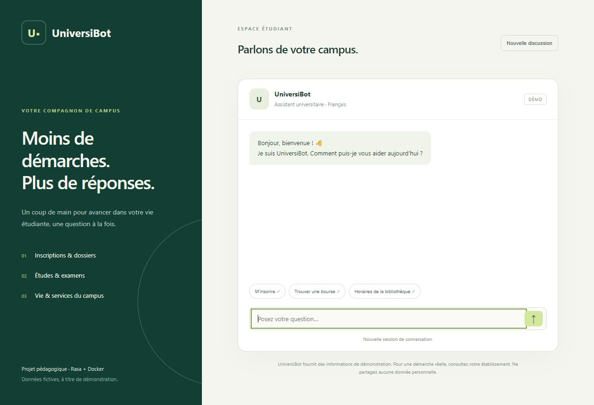
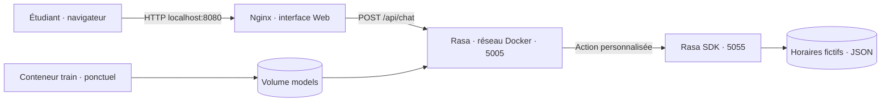

# UniversiBot

## Web interface

[Open UniversiBot](https://MO7KUN.github.io/UniversiBot/)

The GitHub Pages project link automatically opens the chat interface preview. GitHub Pages serves static files only; live conversations require the Rasa backend described below.

**Votre campus, plus simple.** Un assistant universitaire en français, développé avec Rasa Open Source et déployable avec Docker Compose.

[](https://github.com/MO7KUN/UniversiBot/actions/workflows/ci.yml)

UniversiBot aide les étudiants à comprendre les démarches d’inscription, préparer leur dossier et découvrir les services du campus. Ce projet pédagogique illustre toute la chaîne d’une application conversationnelle : conception NLU, dialogue, actions métier, interface Web, conteneurisation et simulation cloud.

> Les procédures, horaires et contacts sont fictifs. UniversiBot ne représente aucun établissement et ne traite aucun dossier étudiant réel.



## Fonctionnalités

- **15 intentions et 120 exemples d’entraînement** en français, avec 15 réponses prédéfinies.
- Reconnaissance des entités `service` et `formation` ; `service` pilote la recherche d’horaires, `formation` illustre l’extraction sans personnaliser la procédure.
- Horaires de trois services, avec demande de précision lorsque le service manque.
- Réponses aux sujets hors domaine et reformulation en cas de faible confiance.
- Interface responsive et accessible : suggestions, historique en mémoire, nouvelle session et gestion des erreurs.
- Trois services Docker : interface Nginx, moteur Rasa et serveur d’actions Python.
- Tests unitaires, jeux d’évaluation distincts et intégration continue GitHub Actions.

## Démarrage rapide

### Prérequis

- Docker Desktop **démarré**, en mode conteneurs Linux, ou Docker Engine sous Linux.
- Docker Compose **2.24.4 ou supérieur** pour la simulation utilisant `!override`.
- Prévoir au moins 8 Go de mémoire disponibles pour Docker et plusieurs Go de disque pour les images ML ; les téléchargements initiaux peuvent être longs.
- Git. Node.js 22 est facultatif, uniquement pour le test HTTP et la prévisualisation.

Les versions pédagogiques sont fixées à Rasa **3.6.20** et Rasa SDK **3.6.2**. Rasa 3.6 est une branche ancienne : valider les dépendances et mises à jour avant tout usage de production. La construction privilégie les conteneurs Linux `amd64` ; les autres architectures ne sont pas validées ici.

```bash
git clone https://github.com/MO7KUN/UniversiBot.git
cd UniversiBot
docker compose build
docker compose --profile tools run --rm train
docker compose up -d --wait
```

Ouvrez **http://localhost:8080**. Le premier entraînement peut prendre plusieurs minutes selon la machine. Le modèle est enregistré dans un volume Docker ; aucun modèle préentraîné n’est inclus dans Git.

Exemples de conversation :

```text
Vous : Bonjour
Vous : Comment m’inscrire ?
Vous : Quels documents fournir ?
Vous : Quels sont les horaires ?
Bot  : Pour quel service souhaitez-vous les horaires… ?
Vous : La bibliothèque
Bot  : Horaires fictifs — bibliothèque : lundi à samedi, de 8 h 30 à 18 h…
```

### Arrêt, diagnostic et réentraînement

```bash
docker compose ps
docker compose logs --tail=100 rasa actions web
docker compose down
# Après modification des données ou des actions :
docker compose build
docker compose --profile tools run --rm train
docker compose up -d --force-recreate --wait
```

`down` conserve le volume du modèle. `down -v` supprime les volumes et impose un nouvel entraînement. N’exécutez pas un entraînement concurrent pendant la démonstration.

Si l’interface ne démarre pas, vérifiez le moteur Docker, la présence d’un modèle entraîné et les journaux. Une erreur de mémoire nécessite davantage de RAM Docker. Le port 8080 doit être libre. Le serveur Rasa et le serveur d’actions attendent leurs contrôles de santé avant l’ouverture de l’interface.

## Architecture



Nginx transmet uniquement `/api/chat` au canal REST Rasa. Les ports 5005 et 5055 ne sont pas publiés sur l’hôte et l’API d’administration Rasa n’est pas activée. Le navigateur communique avec la même origine, sans configuration CORS ouverte.

Les conversations utilisent le tracker en mémoire par défaut : elles disparaissent au redémarrage du serveur. Une nouvelle discussion génère un nouvel identifiant ; elle efface l’affichage local, sans demander la suppression du tracker précédent côté serveur. Les messages ne sont pas stockés dans `localStorage` ; ils peuvent être présents dans la mémoire du serveur ou dans les journaux selon la configuration.

## Organisation du projet

```text
UniversiBot/
├── config.yml                  Pipeline NLU et politiques
├── domain.yml                  Intentions, entités, slot, réponses, action
├── credentials.yml             Canal REST
├── endpoints.yml               Adresse interne du serveur d’actions
├── data/                       nlu.yml, rules.yml, stories.yml
├── actions/                    Action Python et connaissances fictives
├── web/                        Interface et reverse proxy Nginx
├── tests/                      Tests unitaires, NLU et conversations
├── scripts/                    Vérification HTTP et aperçu local
├── deploy/                     Surcharge Compose pour simulation cloud
├── docs/                       Conception, cloud, démonstration, validation
├── Dockerfile
└── docker-compose.yml
```

## Conception conversationnelle

Les intentions couvrent la salutation, les remerciements, l’aide, l’inscription, les pièces du dossier, les frais, les bourses, les examens, les prêts de livres, le logement, le contact, les horaires, la précision du service et les demandes hors domaine.

Le pipeline combine tokenisation, caractéristiques lexicales et caractères, puis **DIETClassifier** pour classifier l’intention et extraire les entités. `EntitySynonymMapper` normalise les synonymes. `FallbackClassifier` déclenche une reformulation sous le seuil de confiance configuré. `RulePolicy` gère les FAQ et les actions déterministes ; `MemoizationPolicy` mémorise les parcours décrits dans les stories.

L’action `action_horaires` consulte une source JSON locale. Elle demande le service s’il manque, normalise accents et alias connus, puis efface le slot après usage pour éviter de réutiliser un ancien choix. Aucun modèle génératif, service payant ou clé API n’est nécessaire.

Voir [la conception détaillée](docs/conception.md).

## Tests et qualité

### Tests légers

Dans un environnement Python 3.10 isolé :

```bash
python -m pip install -r requirements-test.txt
python -m unittest discover -s tests -p "test_*.py" -v
```

Ils vérifient la cohérence des données et le comportement de l’action. Ils ne mesurent pas la précision du modèle NLU.

### Validation, entraînement et évaluation Rasa

```bash
docker compose --profile tools run --rm train data validate --fail-on-warnings
docker compose --profile tools run --rm train train --out /app/models --fixed-model-name universibot
docker compose --profile tools run --rm -v ./results:/app/results train test nlu --model /app/models/universibot.tar.gz --nlu tests/nlu.yml --out /app/results/nlu
docker compose --profile tools run --rm -v ./results:/app/results train test core --model /app/models/universibot.tar.gz --stories tests/test_stories.yml --out /app/results/core
node scripts/smoke.mjs
```

Les arguments d’un `compose run ... train` remplacent sa commande par défaut : `data validate` et `test` sont donc bien transmis à Rasa. Le jeu NLU d’évaluation contient 15 formulations inédites, une par intention ; il est volontairement petit et doit être enrichi avant toute conclusion sur la précision. Les tests Core vérifient les actions prédites ; les tests unitaires et le test HTTP vérifient séparément leur contenu.

L’intégration continue exécute les tests légers, valide les fichiers Rasa, entraîne un modèle et produit les rapports d’évaluation NLU/Core. Elle démarre et teste également les piles principale et de simulation cloud. Les rapports restent consultables comme artefacts du workflow ; ils ne constituent pas une garantie de qualité en production. [État des vérifications](docs/validation.md).

### Prévisualiser uniquement l’interface

```bash
node scripts/preview.mjs
```

Ouvrez http://localhost:8090. Cet aperçu sert uniquement les fichiers statiques : envoyer un message affiche l’erreur prévue tant que le backend Docker n’est pas utilisé. Il n’imite aucune réponse Rasa.

## Simulation cloud et évolution AWS

Une seconde pile Compose, avec son propre réseau, volume et limites de ressources, simule un environnement de déploiement séparé :

```bash
docker compose -p universibot-cloud -f docker-compose.yml -f deploy/cloud-simulation.yml build
docker compose -p universibot-cloud -f docker-compose.yml -f deploy/cloud-simulation.yml --profile tools run --rm train
docker compose -p universibot-cloud -f docker-compose.yml -f deploy/cloud-simulation.yml up -d --wait
```

Interface : http://localhost:8081. Il s’agit d’une simulation locale ; aucune ressource AWS n’est créée. Sous Docker Desktop, les conteneurs Linux s’exécutent dans l’environnement virtualisé fourni par Docker Desktop. Sous Linux natif, les conteneurs partagent le noyau hôte : Compose seul ne crée pas de machine virtuelle.

Le [guide cloud](docs/cloud.md) décrit une installation sur une VM EC2, le réseau, TLS, les images, la persistance et les conditions nécessaires pour plusieurs réplicas Rasa. La pile fournie fonctionne avec **un seul réplica Rasa**, sans haute disponibilité ni autoscaling configuré.

## Personnalisation

1. Remplacez les textes fictifs de `domain.yml` et les horaires de `actions/knowledge.json` par des informations validées.
2. Ajoutez des formulations variées à `data/nlu.yml`, en annotant les entités pertinentes.
3. Ajoutez les intentions, réponses et règles correspondantes ; décrivez les parcours dans `data/stories.yml`.
4. Enrichissez les jeux de tests avec des formulations distinctes de l’entraînement.
5. Validez, reconstruisez et réentraînez avant de relancer les services.

## Démonstration

Un [scénario de démonstration de moins de trois minutes](docs/demo.md) présente le chatbot, ses conteneurs et la simulation cloud. Le dépôt contient le scénario ; aucune vidéo enregistrée n’est incluse.

## Références

- [Rasa — construction et entraînement dans Docker](https://legacy-docs-oss.rasa.com/docs/rasa/docker/building-in-docker/)
- [Rasa — Docker Compose](https://legacy-docs-oss.rasa.com/docs/rasa/docker/deploying-in-docker-compose/)
- [Rasa — composants NLU](https://legacy-docs-oss.rasa.com/docs/rasa/components/)
- [Docker — fusion des fichiers Compose](https://docs.docker.com/reference/compose-file/merge/)
- [AWS — Application Load Balancer avec ECS](https://docs.aws.amazon.com/AmazonECS/latest/developerguide/alb.html)
- [AWS — autoscaling des services ECS](https://docs.aws.amazon.com/AmazonECS/latest/developerguide/service-auto-scaling.html)

## Licence

Code du projet sous [licence MIT](LICENSE). Rasa, Docker, Nginx et leurs dépendances conservent leurs licences respectives.
