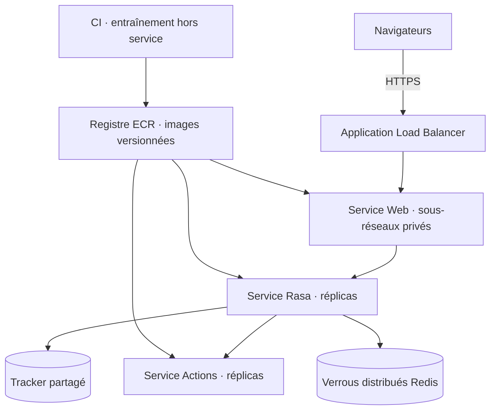

# Déploiement dans un environnement virtualisé et cloud

## Simulation fournie

La surcharge `deploy/cloud-simulation.yml` affecte des limites CPU/mémoire et un port distinct. Le nom de projet `universibot-cloud` crée un réseau et un volume indépendants de la pile locale. La simulation couvre packaging, réseau, ressources et cycle de vie. Elle ne simule ni les zones de disponibilité ni un véritable ordonnanceur cloud.

```bash
docker compose -p universibot-cloud -f docker-compose.yml -f deploy/cloud-simulation.yml build
docker compose -p universibot-cloud -f docker-compose.yml -f deploy/cloud-simulation.yml --profile tools run --rm train
docker compose -p universibot-cloud -f docker-compose.yml -f deploy/cloud-simulation.yml up -d --wait
docker compose -p universibot-cloud -f docker-compose.yml -f deploy/cloud-simulation.yml ps
```

Ouvrir http://localhost:8081. Arrêter avec la même combinaison de nom et fichiers suivie de `down`. La simulation est volontairement accessible uniquement depuis la machine hôte.

## Déploiement minimal sur AWS EC2

Architecture proposée : une VM Linux dans un VPC, disque persistant, Docker Engine et Compose ; un accès SSH restreint, puis les mêmes trois conteneurs. Utiliser une VM `amd64` avec, comme point de départ à ajuster, 2 vCPU, 8 Go de RAM et un disque d’au moins 30 Go. Ce dimensionnement n’a pas été mesuré en charge.

1. Créer la VM et installer Docker/Compose selon les procédures officielles. Cette étape crée des ressources facturables ; aucune création AWS n’est exécutée par ce dépôt.
2. Configurer le groupe de sécurité : SSH uniquement depuis l’adresse d’administration ; ne pas ouvrir 5005, 5055 ou 8080 au public.
3. Cloner le dépôt sur la VM et exécuter les commandes du démarrage rapide. Le volume Docker persiste le modèle sur le disque de cette VM.
4. Pour une démonstration privée, établir un tunnel SSH depuis votre ordinateur :

   ```bash
   ssh -L 8080:127.0.0.1:8080 utilisateur@adresse-de-la-vm
   ```

   Adapter utilisateur et adresse. Ouvrir ensuite localhost:8080 sur l’ordinateur ; le trafic SSH est chiffré.
5. Pour un service public, placer un reverse proxy TLS devant le port local 8080, avec un nom DNS et un certificat valide. Ouvrir uniquement 443 et éventuellement 80 pour le renouvellement/redirection. Ajouter authentification si des données universitaires réelles sont introduites.
6. Sauvegarder le modèle, conserver les journaux avec une durée de rétention adaptée et superviser santé, mémoire, CPU et latence.

Un redémarrage remplace les conversations conservées seulement en mémoire. Une sauvegarde de volume ne remplace pas une politique de persistance du tracker.

## Architecture cible pour la scalabilité



Pour ECS/Fargate, publier les images dans ECR et créer des définitions de tâches et services adaptés. La résolution DNS Compose (`rasa`, `actions`) doit être remplacée par la découverte de services ECS ou des adresses internes ; la pile Compose fournie n’est pas un manifeste ECS. Intégrer le modèle entraîné à une image immuable ou le télécharger depuis un stockage privé au démarrage. Le volume Docker local ne se partage pas automatiquement entre tâches Fargate.

Une mise à l’échelle de Rasa exige **avant tout** un tracker partagé et un verrou distribué compatibles avec Rasa 3.6, ainsi que des tests de concurrence sur une même conversation. Étudier `RedisTrackerStore` et `RedisLockStore` dans la version choisie. Ne pas copier une configuration de verrou d’une version différente sans vérification. Le tracker en mémoire livré ici impose un seul réplica Rasa.

Les actions sont sans état persistant et peuvent être répliquées. Superviser la consommation CPU, la mémoire et la latence avant de choisir une politique d’autoscaling. ECS prend en charge la mise à l’échelle automatique via Application Auto Scaling ; sa configuration et la haute disponibilité restent des évolutions proposées, non implémentées.

Séparer entraînement et service utilisateur. Déployer les réplicas avec le même modèle, versionner les connaissances et prévoir un retour à la version précédente. Utiliser des rôles IAM minimaux et un gestionnaire de secrets pour les éventuels accès de stockage ; ne jamais intégrer des clés dans Git.

## Références officielles

- [Docker Compose : fusion et remplacement des ports](https://docs.docker.com/reference/compose-file/merge/)
- [Rasa : tracker stores](https://legacy-docs-oss.rasa.com/docs/rasa/tracker-stores/)
- [Rasa : lock stores](https://legacy-docs-oss.rasa.com/docs/rasa/lock-stores/)
- [AWS : ALB avec ECS](https://docs.aws.amazon.com/AmazonECS/latest/developerguide/alb.html)
- [AWS : Service Auto Scaling](https://docs.aws.amazon.com/AmazonECS/latest/developerguide/service-auto-scaling.html)
